

  

<h1 align="center">Pipster</h1>

  <b>Smart Pipes. Smarter Automation.</b> 
  Smart item, fluid, gas and energy pipes for Minecraft, with advanced filters, wireless tesseracts and 
  real-time network diagnostics. For Fabric and NeoForge.

  
  
  
  
  
  
  

  <a href="#quick-start">Quick start</a> ·
  <a href="#key-features">Features</a> ·
  <a href="#network-analyzer">Network Analyzer</a> ·
  <a href="#downloads">Download</a> ·
  <a href="#version-status">Versions</a> ·
  <a href="../../wiki">Wiki</a> ·
  <a href="#modpacks">Modpacks</a> ·
  <a href="api/README.md">API for mod developers</a> ·
  <a href="#part-of-the-quantanetwork">QuantaNetwork</a> ·
  <a href="#license">License</a>

> ## ⚠️ Updating is strongly recommended for everyone using 1.5.0, especially on servers.
>
> Pipster 1.5.0 can freeze a server after a few hours when a machine or chest that takes items from a pipe is full again right away, for example a furnace fed by several pipes, which is a very common setup. The server slows down hour by hour until its watchdog stops it. **Update to 1.5.1:** it fixes the cause. No items were lost or created by this fault, and worlds load unchanged.

This repository holds the documentation, the [wiki](../../wiki), the [issue tracker](../../issues) and the
[API for mod developers](api/README.md). The mod itself is downloaded from Modrinth or CurseForge. Pipster is not
open source; see [License](#license).

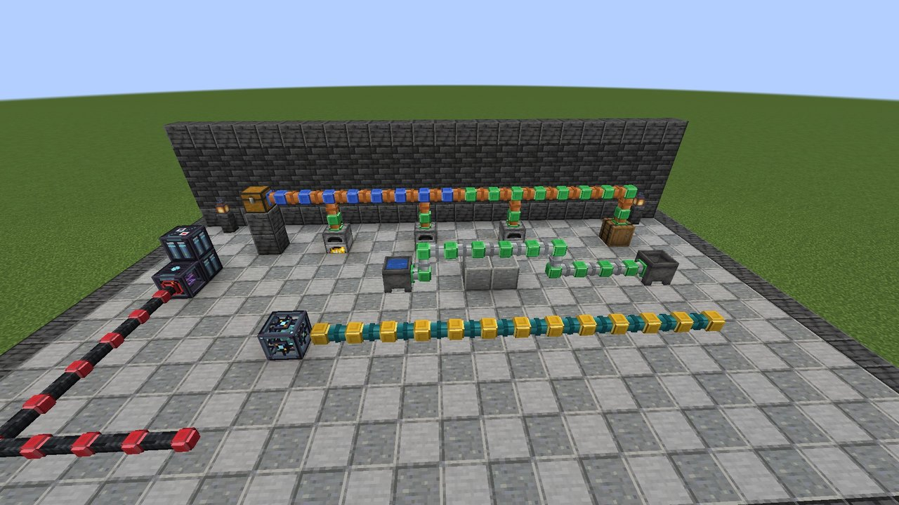

**Your factory. Your network. Your control.**

Pipster brings smart resource transport to Minecraft. Build clean pipe networks for items, fluids, gases and energy,
automate your machines, send resources across dimensions and find out exactly where your factory is stuck. From your
first automated furnace to a sprawling industrial base, Pipster grows with your world.

Every resource type has its own pipe, every pipe looks like a pipe (no full blocks), everything you configure lives
directly at the port where the pipe meets a machine, and the mod tells you why something does not move.

**Connect. Analyze. Control. Scale.**

* **Connect:** flexible networks across your machines and those of other mods, through each loader's standard
  interfaces, with coloured lines and wireless tesseracts.
* **Analyze:** the Network Analyzer shows the load of every pipe, names bottlenecks and blocked ports, and warns you.
* **Control:** filter cards, quantity rules, reserves, priorities, redstone and distribution, right in the port.
* **Scale:** from a Copper line to Quantum networks, upgraded in place, with real per-segment limits and bounded
  server work.

* **Four transport kinds:** item pipes, fluid pipes, gas pipes and energy cables. Different kinds never connect to
  each other.
* **Five tiers:** Copper, Reinforced, Precision, Resonant and Quantum, plus the Singularity tier for energy cables.
  Upgrade pipes in place with an upgrade bolt; the pipe keeps its settings and contents.
* **Network Analyzer (new in 1.5.0):** coloured load dots on every pipe, a report with throughput, blocked ports and
  setups that cannot work, and chat warnings for watched networks. See [Network diagnostics](#network-analyzer).
* **Ports with the Conduit Wrench:** right-click switches the mode, sneak + right-click opens the port screen with
  redstone control, priority, distribution, the face of the target block and copy/paste profiles.
* **Filter cards instead of filter blocks:** put a card into the port itself; quantity rules, reserves and minimum
  batches included.
* **Tesseracts:** send resources through named channels, in one dimension or across all of them.
* **Overcharge:** the Energy Pulse Amplifier stores energy and releases it in short, powerful pulses.
* **Cargo Loader (new in 1.5.0):** pipes fill and empty chest minecarts, hopper minecarts and chest boats.
* **Colours (new in 1.5.0):** dye pipes and cables; two different colours never connect, so parallel lines stay
  apart.
* **Guide in the game (new in 1.5.0):** searchable pages with recipes, troubleshooting, examples and the numbers of
  the mod, in English, German, Portuguese (Brazil) and Spanish. Press **Z** (rebindable) or right-click the Pipster
  Guide; on a looked-at Pipster block it opens that block's page.
* **Honest throughput:** every pipe segment has one shared per-tick budget. A single Copper segment limits a whole
  path, even between Quantum ports. Nothing ignores limits: even the creative-only energy cable has a finite rate,
  and a thinner cable between two of them keeps its own limit.

Your first transfer, from one chest to another. Fluids (fluid pipes between tanks or cauldrons), gas and energy work
the same way.

1. **Craft the basics** (patterns in the guide, JEI, REI, EMI or the [Recipes](../../wiki/Recipes) page):
   * Copper Sleeve: 8 from 6 copper ingots
   * Copper Item Pipe: 8 from 6 Copper Sleeves, 2 glass and a chest
   * Conduit Wrench: 2 iron ingots, redstone and a stick
2. **Connect two chests** with a line of Copper Item Pipes. Where a pipe meets a block that offers storage on that
   side, it ends in a flange with four bolts: that is the **port**.
3. **Set the source to Extract.** Every new port starts as **Insert** (network → block). Right-click the port at the
   source chest with the Conduit Wrench: Insert → Extract → Both → Off. One right-click sets **Extract**; the action
   bar shows it, for example "West: Extract".
4. **Watch it move.** Items flow from the source chest into every port of the network that is set to Insert. If
   nothing moves, sneak + right-click the port: the status line says why, and a click on it starts a test run.
5. **Open the guide** with **Z** or the Pipster Guide item (every player gets one on first join).
6. **Go further:** [Getting Started](../../wiki/Getting-Started), [Examples](../../wiki/Examples) and
   [Troubleshooting](../../wiki/Troubleshooting) in the wiki.

**Classic controls:** on servers with `wrenchClassicControls=true` (and in Pipster 1.3.0 and older) a plain
right-click opens the port screen; click the mode button there until it says **Extract**.

**How to recognise them (new look in 1.3.0):** the tube shows the kind, the node and the flange show the tier.

* **Item pipe:** square copper tube. **Fluid pipe:** round iron-grey tube. **Gas pipe:** round petrol (dark teal)
  tube. **Energy cable:** narrower square anthracite cable with fine insulation rings.
* The **node** is the chamfered cube in the middle; it and the flange have the tier colour (table below).
* A **flange with four bolts** only where a pipe meets a machine; between two pipes a slim coupling; open sides show
  only the node. Pipes stay narrow, never full blocks, and the hitbox follows the pipe.

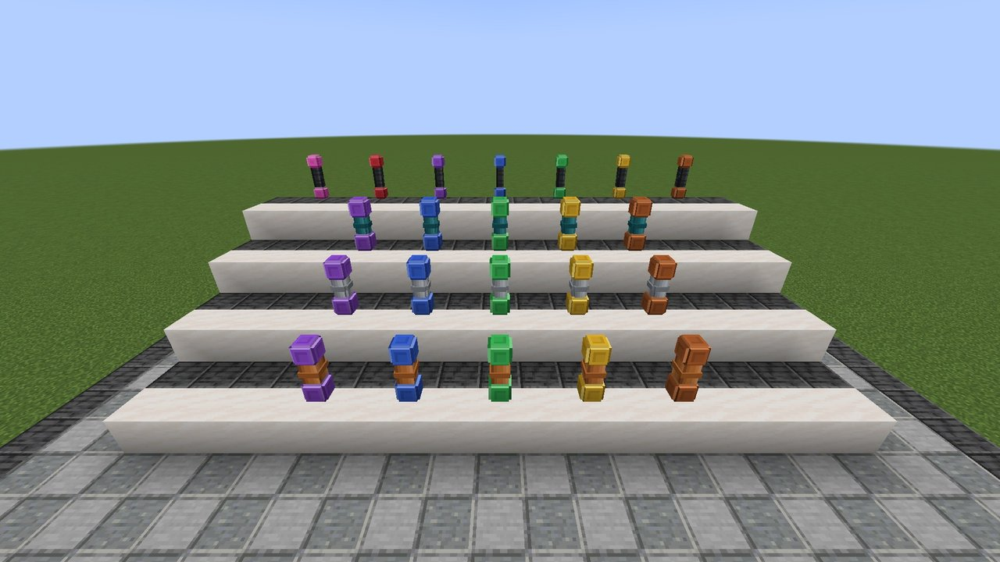

Rates are per pipe segment and tick, shared by all transfers through that segment. They are balance values, not
measured results.

| Tier | Node and flange | Items/t | Fluid mB/t | Gas units/t | Energy E/t | Item batch |
|---|---|---:|---:|---:|---:|---:|
| T1 Copper | copper | 2 | 100 | 100 | 1,000 | 8 |
| T2 Reinforced | gold | 8 | 400 | 400 | 8,000 | 32 |
| T3 Precision | emerald green | 32 | 1,600 | 1,600 | 64,000 | 64 |
| T4 Resonant | lapis blue | 128 | 6,400 | 6,400 | 512,000 | 256 |
| T5 Quantum | amethyst purple | 512 | 25,600 | 25,600 | 4,096,000 | 1,024 |
| T6 Singularity (energy only) | redstone red | – | – | – | 32,768,000 | – |
| Supercalifragilisticexpialidocious Energy Cable (creative only) | magenta, white bolts | – | – | – | 1,000,000,000,000 | – |

* **Upgrading:** right-click a placed pipe with an upgrade bolt (Reinforcement, Precision, Resonance, Quantum,
  Singularity); it keeps its settings and contents, so a base can start small and grow without rebuilding.
  Details in [Pipes and Tiers](../../wiki/Pipes-and-Tiers#upgrading).
* **Singularity Energy Cable (since 1.2.0):** eight times the Quantum cable, energy only. Upgrade Quantum Energy
  Cables with a Singularity Upgrade Bolt or by crafting.
* **Supercalifragilisticexpialidocious Energy Cable (since 1.2.0):** creative mode only. No recipe, no upgrade path,
  and it drops nothing when broken (energy buffered in it is lost). Machines of other mods still decide how much
  they accept.
* **Colours (new in 1.5.0):** right-click a pipe with a dye to colour it; sneak + right-click recolours the whole
  connected run of the same colour (one dye per started 8 pipes, free in creative, up to `dyeNetworkLimit` pipes).
  The colour shows on the coupling sleeves of pipes and the insulation rings of cables. Two different colours never
  connect; uncoloured pipes connect to every colour. A water bucket or a sponge removes the colour, a water cauldron
  washes it off pipe items. In the crafting grid, 1 to 8 pipes of one kind and tier + 1 dye give coloured pipes;
  they keep their colour when broken, placed again and upgraded.

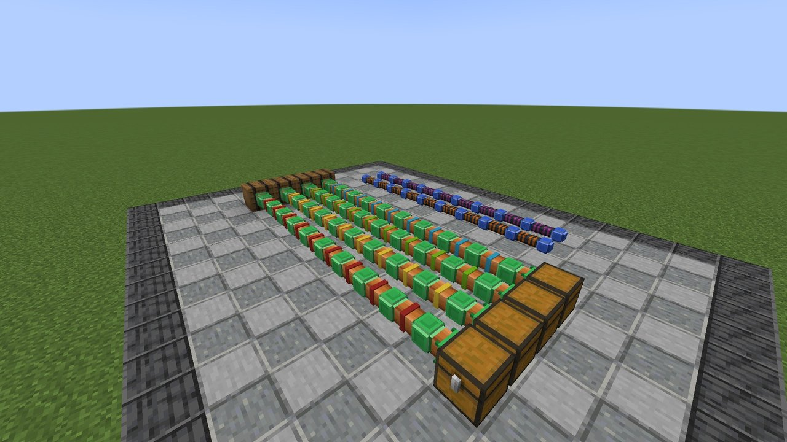

Controls since 1.4.1:

| Action | Effect |
|---|---|
| Right-click a port | next mode: Insert → Extract → Both → Off (an accept port: Accept ↔ Off) |
| Sneak + right-click a port | open the port screen |
| Left-click an arm | disconnect it (also splits networks); left-click the same side of the centre again to reconnect |
| Sneak + left-click a port | paste the active copy profile, with cards from your inventory |
| Right-click an arm without a port, or the centre | show the network in the action bar (network number, tier, nodes, ports, segment use) |
| Sneak + right-click the centre | dismantle the pipe |
| Sneak + right-click into the air | next of 3 copy profiles |

The wrench never breaks pipes by left-click. You need build permission at that spot; the server checks distance and
permission for every action.

**Classic controls:** Pipster 1.3.0 and older, and 1.4.1 or newer on servers with `wrenchClassicControls=true` in
`config/pipster-server.properties`:

| Action | Effect |
|---|---|
| Right-click a port | open the port screen; set the mode there |
| Sneak + right-click an arm | disconnect it; sneak + right-click the same side of the centre again to reconnect |
| Sneak + right-click the centre | dismantle the pipe |
| Sneak + right-click into the air | next copy profile |

With classic controls you paste with the Paste button in the port screen. Left-click does nothing with classic
controls since 1.4.1; in 1.3.0 and older it breaks the pipe like any item. Details in the
[wiki](../../wiki/Ports-and-the-Conduit-Wrench).

* **Port screen:** mode, redstone control, priority, distribution (round robin, nearest first, sticky). The status
  line says why nothing moves, for example "Machine only gives: set this port to Extract", and updates while the
  screen is open.
* **Face of the target block (new in 1.4.1):** the "Face" button picks which face of the block the port uses, for
  blocks that take items only on certain faces (brewing stand: ingredients only from the top).
* **Accept port (new in 1.1.0):** a side next to a block that pushes but offers no storage of its own (AE2 Export
  Bus, Create funnels, Oritech item and fluid pipes) can be set to **Accept**. It takes what the block pushes in and
  never pulls.
* **Copy and paste** port settings with 3 profiles. Since 1.4.1 pasting also moves the matching filter and rule
  cards from your inventory into the port; cards are never created, a replaced card goes back to your inventory.
* **Complete sets (new in 1.5.0):** at a crafter the "Sets" switch replaces the face button. When it is on, the port
  collects items and puts them in only as a whole set, one item per slot, so the crafter never starts with half a
  recipe. With a filter card, field 1 to 9 is grid slot 1 to 9 (marked blue); an empty field keeps its slot empty.
* **Crafters (since 1.4.1):** a port never empties the crafting grid. A port in Extract or Both at the crafter's
  front takes the result the crafter pushes out; Insert and Both fill it evenly, one item per slot.
* **Both ports (changed in 1.5.0):** what a port in mode Both takes out goes back to another Both block only if that
  port has a higher priority. Chests on Both ports fill by priority and then keep still.

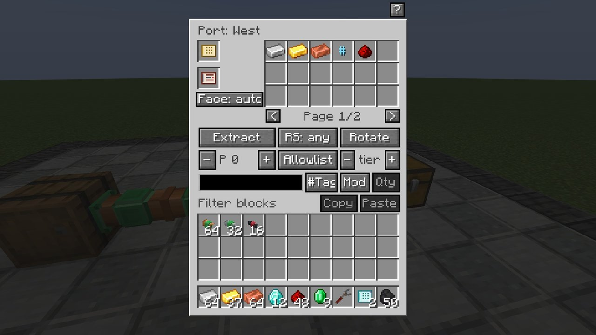

| Card | Rules | What it can do |
|---|---:|---|
| Basic | 9 | exact item, fluid or gas; allowlist or denylist |
| Advanced | 27 | tags, whole mods, exact components such as enchantments |
| Precision | 54 | also "keep N in the source", "fill the target up to N" and (1.5.0) refill "below L, fill up to H" |
| Rule Card | – | per-port rate limit and energy reserve; (1.5.0) minimum amount: the port starts only when the source can give a whole batch |

Patterns are ghost items: nothing is used up.

**Since 1.4.1:** a port in mode Both can have separate filters for what goes in and what comes out ("Filter: both /
in / out" button). With JEI, REI or EMI (1.5.0, Minecraft 1.21.1) installed, drag an item or fluid from the recipe
viewer onto a filter field to set it as the pattern; the server checks that it fits the pipe, and no item is created.

**Since 1.2.0:** fluid and gas pipes have a filter field with suggestions. Type a name or an id and pick a fluid,
gas or (with Mekanism on NeoForge 1.21.1) chemical from the list; no filled container needed. `#` lists the tags of
the pipe's type, "Everything from `<mod>`" covers a whole mod, and entries with the same name show their mod in
brackets. The server checks that every entry fits the pipe.

**What you can automate with it:**

* **Keep a furnace fuelled:** Insert port at the furnace's side, Precision Filter Card with coal and the refill rule
  `16-64`: below 16 the pipe tops it up to 64.
* **Keep a reserve in storage:** "keep 64 in the source" on the storage chest's port, so machines take from it but
  never empty it.
* **No half recipes:** "Sets: on" at a crafter, the recipe pattern in fields 1 to 9 of the filter card.
* **Important machines first:** priority 10 on the machine that must never run dry, priority −10 on an overflow chest.
* **Batches instead of trickles:** a Rule Card minimum amount moves ores only in batches of 32.
* **Energy backup:** a Rule Card reserve on the battery port of secondary machines keeps energy for the important ones.

Every build with its settings explained: [Examples](../../wiki/Examples).

**Stop guessing. Find your bottlenecks.** A machine gets nothing and you do not know why. Pipster has two diagnostic
layers: the **Network Analyzer** looks at a whole network, the **port screen** explains a single port.

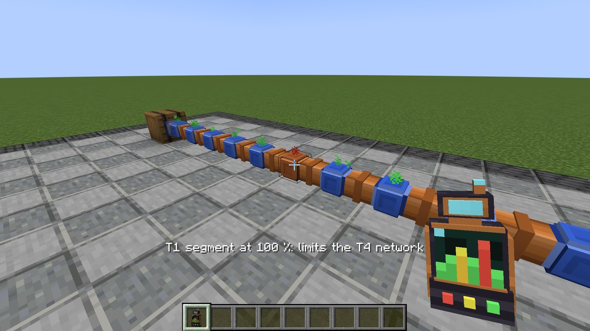

**Network Analyzer (new in 1.5.0):**

* **In the hand:** look at a pipe. Every pipe of that network within 24 blocks shows a coloured dot: grey (nothing in
  the last 5 seconds), green (below half), yellow (busy), red (95 % or more: a bottleneck). The line above the
  hotbar explains the pipe you look at, for example "T1 segment at 100 %: limits the T4 network", and names a port of
  that pipe that is not moving and why.
* **Right-click** opens the report: **Overview** (delivered per second, the busiest segment with its position,
  moving, waiting and blocked ports, the five most loaded segments), **Problems** (every blocked port with its reason
  and setups that cannot work, such as an allowlist without an active rule or a quantity rule that does nothing in
  that mode) and **Failed checks** (how often ports could not deliver in the last 5 seconds, by cause).
* **Sneak + right-click** watches a network. The owner of the pipe gets a chat message when a pipe stays full
  (95 % or more) for a minute, a port is quarantined or the network is larger than the server allows; at most one
  message per network every 10 minutes. Servers set who is told and the times (`networkWarnings`,
  `networkWarningSeconds`, `networkWarningCooldown`).
* The server measures a network only while someone holds the analyzer and looks at it, or while it is watched. You
  only see networks at pipes where you may build. Values are measured over the last 5 seconds, not promised.

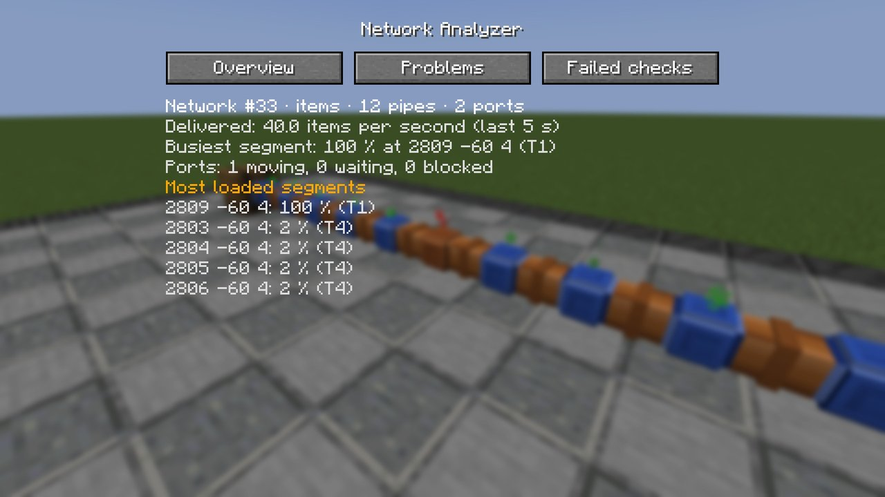

**Port diagnostics:**

* **Status line:** "Active", "Idle", "Source empty", "Targets full", "No targets", "Filter blocks", "Redstone
  blocks", "Budget exhausted", "Network rebuilding", "Deferred (server work limit)", "Quarantined: faulty foreign
  handler", "Protected by a claim" and more; the full list is in
  [The status line](../../wiki/Ports-and-the-Conduit-Wrench#the-status-line).
* **Test run (new in 1.5.0):** click the status line. The port plays its next transfer through without moving
  anything and lists what the block holds, what the filter lets out, every target with what it would take, the
  slowest pipe and why nothing would move. Nothing is moved and no limit is used up.
* **Comparator (new in 1.5.0):** a comparator next to a pipe gives 15 when a port of that pipe cannot deliver because
  every matching target is full or there is none; otherwise 0. It can lag by up to about 3 seconds in an idle
  network.
* **Jade, WTHIT, The One Probe and CC: Tweaked** show the same port state; CC: Tweaked also reads the warning state of
  watched networks.

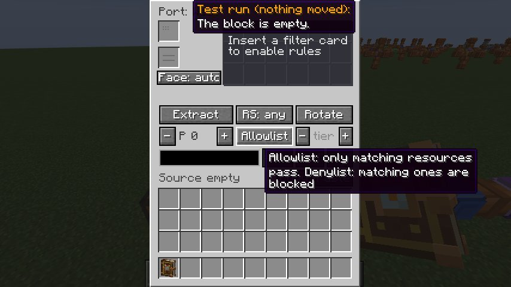

Step by step through every reason: [Troubleshooting](../../wiki/Troubleshooting).

* **Resonant Tesseract:** any distance in the same dimension, T4 speed.
* **Quantum Tesseract:** all dimensions of a server, T5 speed. A channel between a Resonant and a Quantum Tesseract
  works only within one dimension.
* One channel per resource type per tesseract, private, invite-only or public, filters per side. Teams share their
  channels with FTB Teams or Open Parties and Claims parties.
* A transfer uses at most one tesseract jump. The channel binding is not kept in a broken tesseract, so access
  control cannot be bypassed by handing it to someone else.
* Tesseract channels only work while all involved chunks are loaded. Pipster never loads chunks on its own.

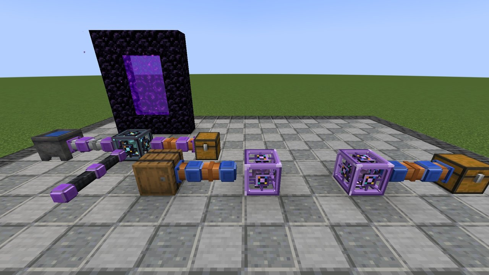

More in [Tesseracts](../../wiki/Tesseracts).

The **Energy Pulse Amplifier** is a buffered pulse source for machines that need a lot of energy for a short time.
It takes energy evenly, stores it at **90 % efficiency** and releases it for a short time at a higher rate than it
takes. It never creates energy: more output than input is only possible while the store lasts.

* **Front = output**, every other side = input. The amplifier pushes into the cable at its front and respects that
  cable's budget, so a thin cable limits the pulse. On Singularity and creative cables its own pulse limit applies.
* **Capacitor Banks** next to it (or next to another bank of the group) add capacity and pulse power, up to 8 banks.
  A bank group that touches two amplifiers counts for neither.
* **Modes:** Auto (gives whenever something takes), Charge (gives nothing), Pulse (full power while fired by
  redstone or the Fire button; starts from 10 % charge, after an empty pulse only again when Ready).
* **Screen:** stored and capacity, input and output per tick, efficiency, banks, pulse limit, mode, target and status
  (Charging, Ready, Pulsing, Empty).
* **Looks and sounds:** the coil turns faster with the charge and very fast during a pulse, glowing, with sparks;
  charge lights on the pillars; sounds for activation, hum, ready, pulse and wind-down.
* Breaking it keeps the stored energy in the item; creative pick-block never copies it.

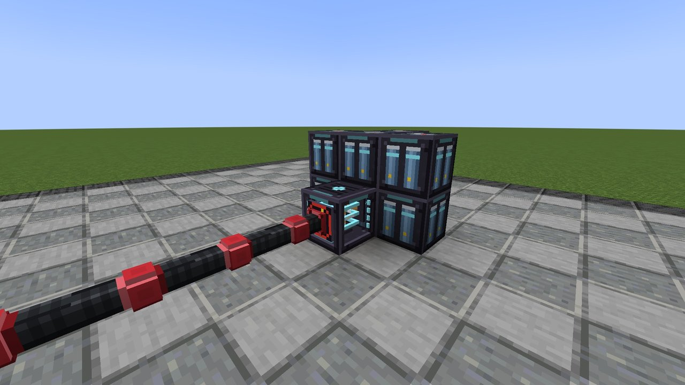

| Default value (server config) | |
|---|---:|
| Store of the amplifier | 1,000,000 E |
| Per Capacitor Bank | +1,000,000 E |
| Input | 16,000 E/t |
| Pulse limit | 32,000 E/t + 4,000 E/t per bank |

1 E = 1 FE = 1 Team Reborn Energy unit. Full pulse power needs at least a Precision cable. More in
[Overcharge: Pulse Amplifier](../../wiki/Overcharge-Pulse-Amplifier).

The **Cargo Loader (new in 1.5.0)** links classic Minecraft transport with pipe networks. Put it under the rail
(minecarts) or under water (chest boats). Pipes connect to it like a chest: an Insert port fills the chest minecart,
hopper minecart or chest boat above it, an Extract port empties it, with filters, quantity rules and priorities as
usual. It stores nothing itself, looks only at the one block above it and never loads chunks; a comparator shows how
full the vehicle is, so a powered rail can hold the cart until it is loaded and then send it on.

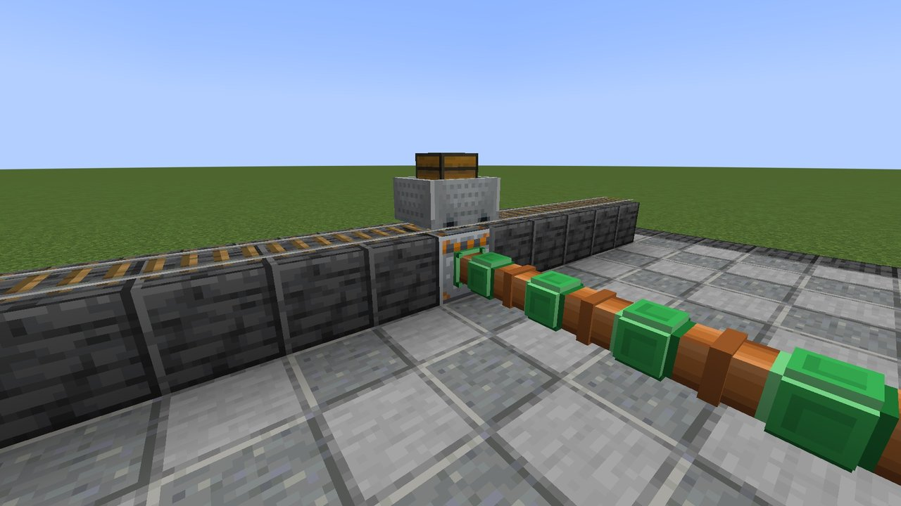

On NeoForge it also works with vehicles of other mods that offer their items to automation; on Fabric with vehicles
that use the vanilla container. See [Cargo Loader](../../wiki/Ports-and-the-Conduit-Wrench#cargo-loader-new-in-150).

* Press the **guide key** (default **Z**, rebindable under "Pipster" in the controls) or right-click the **Pipster
  Guide**. On a looked-at Pipster block it opens that block's page; the **?** buttons in the screens of ports,
  tesseracts and the pulse amplifier open the matching page.
* **Ctrl+F** searches all pages, the star keeps a page in your favourites, and every recipe, example and
  troubleshooting step is inside.
* Numbers such as throughput and server defaults come from the mod itself, so they fit your version.
* English, German, Portuguese (Brazil) and Spanish. Resource packs can replace the pages.
* Every player gets the guide item once on first join (`giveGuideOnFirstJoin`); it can also be crafted from a book
  and a Copper Item Pipe. The wiki pages of the same topics are generated from the same source.

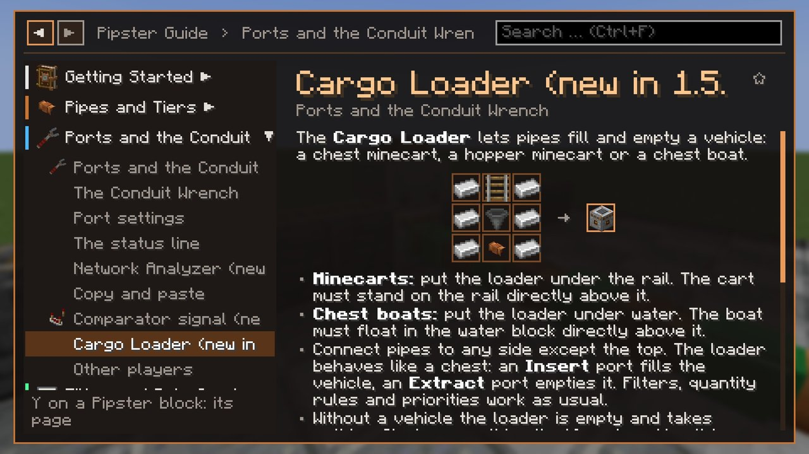

Pipster talks to other mods through the standard interfaces of each loader. It has no hard dependency on any
content mod.

| Resource | Fabric | NeoForge |
|---|---|---|
| Items | Fabric Transfer API | NeoForge item capability |
| Fluids | Fabric Transfer API | NeoForge fluid capability |
| Energy | Team Reborn Energy (included) | NeoForge energy capability |
| Gas | Pipster gas API, plus fluids tagged `#pipster:gaseous` | Pipster gas API, fluids tagged `#pipster:gaseous`, Mekanism chemicals (1.21.1) |

Mod developers find the exact interfaces per version in the [API documentation](api/README.md).

**Tested with the real mods** (dedicated server, client and all game tests; the game tests also send items, fluids
and energy through real blocks of these mods and back, and check that nothing is lost or created). The table shows
the partner runs of the 1.5.0 release check. Since 1.5.0 the game tests also call the built-in integrations (CC:
Tweaked methods, the Jade, WTHIT and The One Probe providers, the Mod Menu button).

| Mod | Where | What is checked |
|---|---|---|
| Storage Drawers | all versions, both loaders | drawers and compacting drawers (no duplication) |
| Sophisticated Storage | NeoForge, all versions; Fabric 1.21.1 (unofficial port) | barrels |
| Energized Power | all versions, both loaders | battery box, fluid tank |
| Oritech | 1.21.1 both loaders; NeoForge 26.1.2 (beta) | energy storage, tank |
| Powah! | NeoForge 1.21.1; 26.1.2, 26.2, 26.3 (alpha builds) | energy cell |
| Tech Reborn | Fabric 1.21.1, 26.1 – 26.1.2, 26.2, 26.3 | energy storage, tank (its storage units are not covered) |
| Mekanism | NeoForge 1.21.1 | energy cube, fluid tank, chemicals through gas pipes |
| Create | NeoForge 1.21.1 | fluid tank, Mechanical Arm targets item pipes |
| Applied Energistics 2 | NeoForge 1.21.1 (with Applied Mekanistics), 26.1.2 – 26.3 | starts and runs together |
| Immersive Machinery | 1.21.1, 26.1.2, 26.2, both loaders | starts and runs together (it has no blocks to connect) |
| Carry On, Tom's Simple Storage | 1.21.1, 1.21.11, 26.1.2, 26.2, 26.3, both loaders | start and run together |
| Item Collectors (1.5.0) | all versions, both loaders, except NeoForge 26.1 (it does not start there) | a collector pushes picked-up items into an Accept port |
| Industrial Foregoing, Draconic Evolution (1.5.0) | NeoForge 1.21.1 | their machines take energy through Pipster cables |
| Modern Industrialization (1.5.0) | NeoForge 1.21.1 | barrel and tank in both directions; its energy (EU) reaches other cables only with its setting `bidirectionalEnergyCompat=true` (not tested) |

"Where" lists the Minecraft versions on which the run was made; for 26.1 and 26.1.1 fewer partner mods exist, so
the 26.1 to 26.1.2 files were tested with several of them on 26.1.2 only. That is not a promise that every mod or
every block works; please [report problems](#reporting-bugs).

What else to know:

* **Mekanism chemicals** (NeoForge 1.21.1): gas pipes move hydrogen, steam, sodium, coolants, fuels and waste.
  Radioactive chemicals are released like Mekanism does when a pipe is broken and never travel in the item.
* **Fabric energy:** ports in Extract or Both actively pull energy (config `fabricEnergyPull`, on by default), so
  generators that push to the wrong side or not at all still work.
* New energy ports next to a block that only gives start in Extract mode. Saved ports never change.
* **Gaseous fluids of other mods** (since 1.4.1): oxygen and hydrogen of Ad Astra, the gases and steams of Modern
  Industrialization and the gases and helium plasma of Tech Reborn are in `#pipster:gaseous` and travel in gas
  pipes. A datapack can replace the tag with an empty list.
* **Moving Pipster blocks** with Carry On, Create contraptions or the Mekanism cardboard box: automated tests move
  pipes and tesseracts the way these mods do; contents, cards and channel bindings move with the block.

### Built-in optional integrations

These mods are **never required**. Install them and Pipster uses them; without them nothing changes. Each
integration is included for the Minecraft versions where the other mod has a release (see the
[wiki](../../wiki/Supported-Versions#integrations)).

| Mod | What you get |
|---|---|
| [Jade](https://modrinth.com/mod/jade), [WTHIT](https://modrinth.com/mod/wthit) (1.4.1), [The One Probe](https://www.curseforge.com/minecraft/mc-mods/the-one-probe) (1.5.0) | Look at a pipe, tesseract or pulse amplifier: port mode and status, a chosen face, separate filters, colour, comparator signal, bound channels (names only if you have access), charge and status. The One Probe: all versions except 1.21.11 Fabric. |
| [JEI](https://modrinth.com/mod/jei), [REI](https://modrinth.com/mod/rei) (1.4.1), [EMI](https://modrinth.com/mod/emi) (1.5.0, Minecraft 1.21.1) | Drag an item or fluid from the recipe viewer onto a filter field of the port screen to set the pattern. |
| [Mod Menu](https://modrinth.com/mod/modmenu) (1.5.0, Fabric) | Opens Pipster's settings screen. On NeoForge the mod list has its own config button. |
| [CC: Tweaked](https://modrinth.com/mod/cc-tweaked) | Computers read pipes, tesseracts and pulse amplifiers, and (1.5.0) the warning state of watched networks. With the redstone mode "Computer" they can switch ports. |
| [Open Parties and Claims](https://modrinth.com/mod/open-parties-and-claims), [FTB Chunks](https://www.curseforge.com/minecraft/mc-mods/ftb-chunks-forge), [Flan](https://modrinth.com/mod/flan) (1.4.1) | Claim protection: pipes cannot pull from or push into blocks in someone else's claim. With Flan, pipes and tesseracts follow Flan's "piston border" flag. |
| FTB Teams, Open Parties and Claims parties | Team sharing: teammates share channels, tesseracts and pipes, also for things placed before they joined. |
| LuckPerms and other permission mods | Permission nodes `pipster.admin` and `pipster.command`. Without a permission mod, operators (level 2) keep these rights. |
| Create | The Mechanical Arm can target item pipe sides (NeoForge 1.21.1). |
| Mekanism | Chemicals through gas pipes (NeoForge 1.21.1). |

The Conduit Wrench is also tagged `c:tools/wrench`, so other mods recognise it as a wrench.

**Built for players. Ready for modpacks.**

**Pipster is welcome in public and private modpacks, free or paid. No separate permission is needed, as long as the
jar files stay exactly as published and the [license](LICENSE) is respected.** Where the modpack platform can link
to the official download instead of copying the file, linking is preferred.

* **Fabric and NeoForge**, one tested jar per Minecraft version and loader (see [Version status](#version-status)).
* **No required content mods.** Fabric needs Fabric API (Team Reborn Energy is included), NeoForge nothing else.
  All integrations above are optional.
* **Balance and limits:** server work limits, the maximum network size, network warnings, the wrench controls and
  every Pulse Amplifier value are server settings ([Configuration](../../wiki/Configuration)). Pipe throughput per
  tier is fixed by design, so recipes and tiers mean the same in every pack.
* **Datapack tags:** `pipster:gaseous` (fluids that travel in gas pipes), `pipster:energy_no_insert` (never push
  energy into these blocks, e.g. Powah reactor parts), `pipster:no_extract` (never take anything out; default: the
  crafter), `pipster:insert_one_by_one`, `pipster:complete_sets` and `pipster:extract_warning` (warn when an extract
  port could pull storage media out of a drive). See [Datapack options](../../wiki/Configuration#datapack-options).
* **Multiplayer protection:** claims, teams and permission nodes (see [Server and multiplayer](#server-and-multiplayer)).
* **Testing and performance** are documented per release (see [Performance and testing](#performance)).
* **API for add-ons:** see [API for mod developers](#api).

* Everything is decided on the server. Clients only see pipe shapes and the screen data they are allowed to see.
* Every screen action is checked on the server: session, distance, build permission, tesseract channel access, and
  a revision number so stale screens cannot overwrite newer settings.
* Claims (Open Parties and Claims, FTB Chunks, Flan) stop pipes from pulling out of or pushing into protected blocks;
  teams (FTB Teams, Open Parties and Claims parties) share channels, tesseracts and pipes.
* Permission nodes `pipster.admin` and `pipster.command` work with LuckPerms and other permission mods; operators keep
  them without one.
* Tesseract channels only work while all involved chunks are loaded. Pipster never loads chunks on its own.
* Creative pick-block never copies buffered resources, filter cards or stored energy.
* Server settings live in `config/pipster-server.properties` (see the [wiki](../../wiki/Configuration)). Since
  1.5.0 they can also be edited in the game (Mod Menu on Fabric, the mod list on NeoForge); operators reload a
  running server with `/pipster config reload`.

Pipster does no work per pipe per tick. It keeps one transport graph per dimension and resource type on the server,
rebuilds it in bounded steps, lets idle ports back off, and never loads chunks or scans the world.

**Measured with 1.5.0** on a laptop (Intel Core i7-13700H, 32 GB RAM) with a dedicated server: 10,000 idle pipes
need about 0.01 ms per tick, 500 busy ports on 50,000 pipes about 3 to 5 ms, and a mixed base with items, fluids,
gas, energy, tesseracts and crafters about 2 ms. A server tick has 50 ms. All scenes, the method and the notes on the
measurement are in the wiki under [Performance](../../wiki/Performance). Measured numbers only ever hold for that
machine and those scenes; they are no guarantee of 20 TPS on other hardware or in other worlds. The tier rates in
[Pipes and Tiers](#pipes-and-tiers) are balance values, not measurements.

**Testing:** before a jar is released, it is tested on its Minecraft version: client and dedicated server started,
and all automated game tests (item, fluid, energy and gas transport, throughput limits, filters, tesseracts, the
pulse amplifier, claims and teams, break/place with stored contents, save/load, network packet checks), plus runs
with the integrations and partner mods above wherever those exist. Worlds of the previous version are loaded with the
new jar in an upgrade test.

Pipster 1.5.1 has one jar per Minecraft version and loader; one jar per loader covers 26.1, 26.1.1 and 26.1.2
(tested unchanged on all three).

| Minecraft | Fabric jar | NeoForge jar |
|---|---|---|
| 1.21.1 | `pipster-1.5.1+mc1.21.1-fabric.jar` | `pipster-1.5.1+mc1.21.1-neoforge.jar` |
| 1.21.11 | `pipster-1.5.1+mc1.21.11-fabric.jar` | `pipster-1.5.1+mc1.21.11-neoforge.jar` |
| 26.1, 26.1.1, 26.1.2 | `pipster-1.5.1+mc26.1-26.1.2-fabric.jar` | `pipster-1.5.1+mc26.1-26.1.2-neoforge.jar` |
| 26.2 | `pipster-1.5.1+mc26.2-fabric.jar` | `pipster-1.5.1+mc26.2-neoforge.jar` ¹ |
| 26.3 | `pipster-1.5.1+mc26.3-fabric.jar` ² | `pipster-1.5.1+mc26.3-neoforge.jar` ¹ |

¹ Needs at least NeoForge 26.2.0.93 or 26.3.0.100 (26.3 raised in 1.4.1, 26.2 since 1.1.0; current partner mods
need these builds).
² Needs at least Fabric API 0.165.2+26.3 (raised in 1.4.1; WTHIT needs it).

**Other Minecraft versions** (1.21.2 – 1.21.10): use Pipster 1.2.0. It stays available and keeps
working. Builds for further versions only come back if enough players ask for them in the
[issue tracker](../../issues/new?template=version_request.yml).

Release check of the ten 1.5.1 files: passed on 2026-11-25: each of the ten files on every Minecraft version it covers (dedicated server, client, all game tests) and with the partner mods of that version. 468 runs passed, none failed; 12 runs could not take place because Open Parties and Claims cannot start on a game-test server (it is checked on the dedicated server instead).
The exact loader versions are listed in the wiki under [Supported Versions](../../wiki/Supported-Versions).

Mod developers may compile against the Pipster API to make their mods work with Pipster (see [License](#license)):

* **Gas API:** register gases and offer gas handlers for Pipster's gas pipes.
* **Endpoint providers:** let Pipster talk to blocks that have no standard loader interface.
* **CC: Tweaked methods:** what computers can read and switch.

The reference is in [api/README.md](api/README.md), the overview in [For Mod Developers](../../wiki/For-Mod-Developers).
The API jar and its javadoc are attached to the GitHub releases (tag `api-1`); do not shade them into your mod.

* [Modrinth](https://modrinth.com/project/pipster)
* [CurseForge](https://www.curseforge.com/minecraft/mc-mods/pipster)

Please download Pipster only from these pages (each version's jars are also attached to its GitHub release). Pick the
file for your exact Minecraft version and loader. The [wiki](../../wiki) explains how to play, recipes, tesseracts,
the pulse amplifier, configuration and the FAQ; the [API documentation](api/README.md) covers gas handlers, endpoint
providers and the CC: Tweaked methods.

Pipster is part of the **QuantaNetwork**, a family of tech mods by cptgummiball that work together through public,
standard interfaces:

* [Pipster](https://github.com/CptGummiball/Pipster): smart pipes for items, fluids, gases and energy, with filters, tesseracts and network diagnostics.
* [QNet](https://github.com/CptGummiball/QNet): industry, power, storage, logistics and dimensional extraction in one mod.

Pipster is a standalone mod and needs none of the other network mods.

Please open an [issue](../../issues/new/choose) with:

* Minecraft version, loader (Fabric/NeoForge) and loader version
* the Pipster jar name (it contains the Pipster and Minecraft version)
* the other mods involved, if the problem is with a specific machine
* `logs/latest.log`, and a crash report if there is one

Questions about a setup are often answered faster by the [FAQ](../../wiki/FAQ) and
[Troubleshooting](../../wiki/Troubleshooting). Content creators who want to showcase Pipster are welcome to get in
touch through an issue or the [Discord](https://discord.gg/5xt3Yencgq).

Pipster is **not open source**. All rights reserved by cptgummiball; see [`LICENSE`](LICENSE). In short:

* You may play with Pipster, use it on any server and show it in videos and streams.
* You may put Pipster into **modpacks**, as long as the jar files stay exactly as published.
* You may **not** modify, decompile, re-upload or otherwise redistribute Pipster, or use its textures, models and
  sounds elsewhere.
* Mod developers may compile against the [Pipster API](api/README.md) to make their mods work with Pipster.
* For anything else, open a [permission request](../../issues/new?template=permission_request.yml).

Pipster is made by **cptgummiball**. It is inspired by the readability of classic pipe mods, but contains no code or
assets from other mods. Pipster is not an official Minecraft product and is not associated with Mojang or Microsoft.
